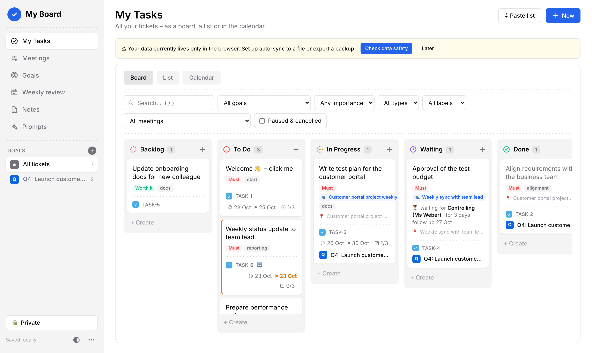
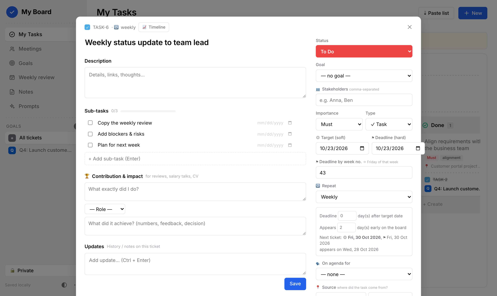
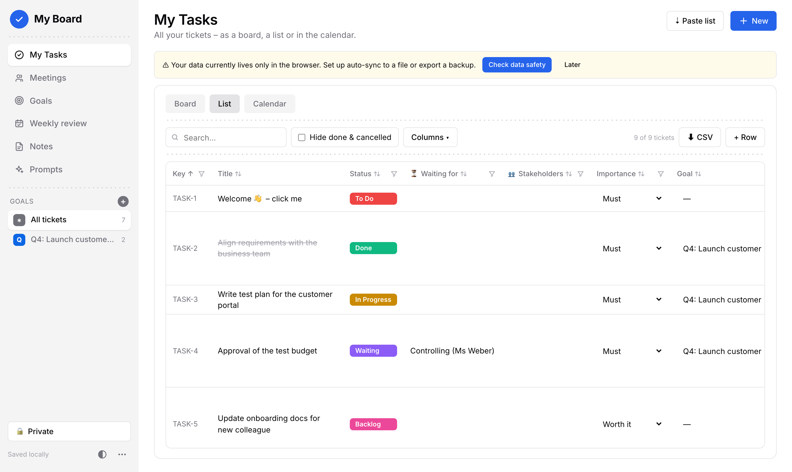
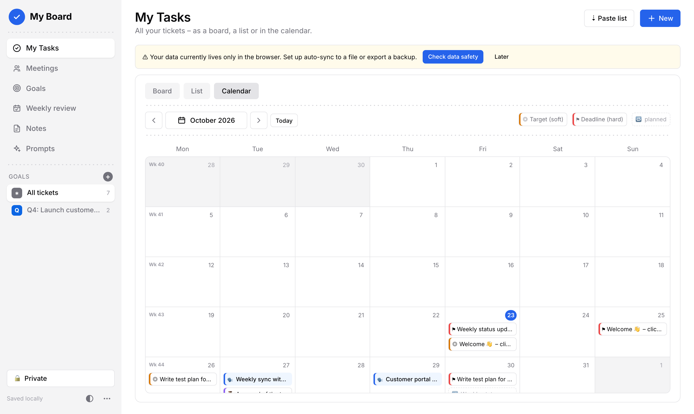

# Doing-App (Prototype)

> No Jira and no decent to-do app on my work laptop, so I just built one myself. lol

A Jira-style personal to-do board in **one single HTML file**. No install, no server, no account. Open it in the browser, start working, everything saves automatically.

| File | Language |
|---|---|
| `Doing-App_Prototype.html` | German UI |
| `Doing-App_Prototype_en.html` | English UI (separate data) |

Works in **Edge, Chrome and Firefox** (Firefox without auto-sync to file, see below). Design inspired by [sanidhyy/jira-clone](https://github.com/sanidhyy/jira-clone).

| Ticket | List | Calendar |
|---|---|---|
|  |  |  |

## Quick start
1. Open the HTML file in your browser.
2. **Menu (bottom left) > Check data safety** → set up **auto-sync to a file** (e.g. in OneDrive).
3. Delete the example tickets, add your own with **+ New** (`C`) or **Paste list** (`L`).

## Features
- **Board / List / Calendar:** Kanban with drag & drop and filters. Excel-like list with column filters, inline editing and CSV export. Month calendar with deadlines, follow-ups and meetings.
- **Tickets:** sub-tasks (with own due dates), updates log, labels, importance (*Must / Worth it / Nice-to-have*), soft target + hard deadline (also as week number, `43` → Friday), *waiting for X* with follow-up, paused, cancelled (with reason), source meeting, stakeholders.
- **Recurring tasks:** weekly, every 2 weeks, specific weekdays, monthly (date, n-th weekday, last or n-th working day), quarterly.
- **Paste list:** paste action items (e.g. from OneNote), each line becomes a ticket. Indent = sub-task, `#label`, `KW43` / `24.10.` = deadline, `!` = must, `@Name` = waiting for, `+Name` = stakeholder. Live preview first.
- **Meetings:** rhythm, agenda from tickets, auto-generated sync prep text for your manager.
- **Weekly review:** done / in progress / waiting / overdue / next week as text for Teams or Outlook.
- **Goals:** group tickets, progress bar, overview of recurring tasks.
- **Timeline:** status flow and durations per ticket, Gantt + stakeholder Venn per goal.
- **Wins export:** *what I did / role / impact* per ticket → CSV brag sheet for reviews, salary talks, CV.
- **Notes & AI prompts:** templates to turn notes into tickets; paste the AI's JSON answer back to import.
- **Obsidian sync (both ways):** one Markdown note per ticket in a vault folder, auto-sync every 5 min, conflict dialog, ZIP fallback. Everything below `## Eigene Notizen` stays untouched.
- **Show mode:** hides private tickets, notes and logs for screen sharing (visual only, no encryption).
- **Features on/off:** hide 17 features you don't need. Data stays saved.

## Data safety
| Layer | What it does |
|---|---|
| Browser storage | Saved ~0.3 s after every change (`localStorage`). |
| Auto-sync file | Every change is also written to a JSON file (Edge/Chrome only). After a browser restart click **Resume** once. |
| Backup | Menu > *Export backup (JSON)*. Restorable; older backups import fine. |

Browser data is gone if site data is cleared, "clear on close" is on (common on company PCs, check `edge://settings/clearBrowsingDataOnClose`), in private windows, or on another PC/browser. **Check data safety** in the menu tests all of this, including a restart test.

**Firefox:** no auto-sync file (no File System Access API), and data is stored **per file path**. Renaming or moving the file shows an empty board, so export a backup first.

## Shortcuts
`C` new ticket · `L` paste list · `N` new note · `/` search · `Esc` close · `Ctrl+Enter` save update

## Limitations
Single user, single device. No notifications while closed (recurring tickets appear on next open). Recurrence ignores public holidays. No drag & drop on touch devices.

## Tech
Plain HTML, CSS and vanilla JS in one file. No build step, no dependencies. Data in `localStorage`, file sync via File System Access API (handle kept in IndexedDB).

## Changelog
**1.1.0 – 2026-10-22:** two-way Obsidian sync, 13 more feature toggles, *All tickets* filter in the sidebar. Fully compatible with 1.0 in both directions. To update, replace the HTML file *at the same path* (export a backup first to be safe).

**1.0 – 2026-10-22:** board, list, calendar, goals, meetings, weekly review, notes & prompts, stakeholders, sub-task due dates, wins export, timeline, features on/off.
